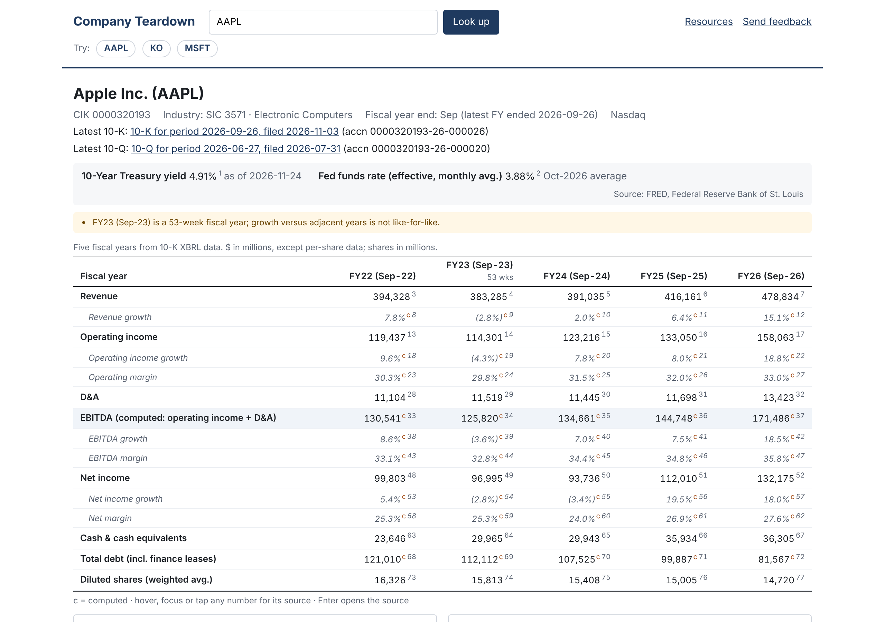

# Company Teardown

**Type a US public company's ticker. Get a one-page, banker-style profile built only from free public data, with a source on every number.**

**Live demo:** [richelin-teardown.netlify.app](https://richelin-teardown.netlify.app) · [Send feedback](https://github.com/richelin5/TeardownTeam/issues/new?template=feedback.yml) · Built by [Richelin Aristilde](https://www.linkedin.com/in/richelin-aristilde)



## What it does
- **Search any US filer by ticker.** It shows the company name, industry (SIC), fiscal year end, and links to the latest 10-K and 10-Q.
- **Five fiscal years of core financials:**
  - Revenue, operating income, net income and D&A.
  - EBITDA (labeled *computed: operating income + D&A*).
  - Cash, total debt (incl. finance leases) and diluted shares.
  - Growth rates and margins, a table and two charts.
- **Rates context from FRED:** the 10-year Treasury yield and the fed funds rate, each with its date.
- **A source on every number.** Hover, tap or focus any figure to see the form, filing date, XBRL tag and accession number. Press Enter to jump to the filing link. Computed figures say so and show their formula.
- **No guessing.** If a company doesn't report a value in standard XBRL, the page says **"not reported"**. Ratios that exist but mean nothing (e.g. growth from a negative base) say **"n.m."**
- **Prints on one landscape page**, with lettered source endnotes, like a pitch-book tear sheet.
- **Free, official data only:** SEC EDGAR and FRED. No AI is used to produce any number.

## How it checks its numbers
1. **Straight from the filings.** Figures come from the SEC's XBRL data for each company's own 10-K filings. The app picks the right fact for each fiscal year by period dates, not by labels. That matters, because the SEC tags Apple's FY2017 revenue with `fy: 2019`.
2. **Tied out against the actual 10-Ks.** An independent tie-out compared every displayed value with the companies' real 10-K financial statements. It also checked every cited source (tag, accession number, period, value) against the raw SEC data:

| Company | Fiscal year end | Checks passed |
|---|---|---|
| Apple (AAPL) | September (52/53-week) | 94 / 94 |
| Microsoft (MSFT) | June | 99 / 99 |
| Coca-Cola (KO) | December | 94 / 94 |

3. **Honest where the data is messy.** Microsoft reports D&A only in a company-specific XBRL tag that the SEC's standard data doesn't include. The page therefore shows a clearly labeled *computed* D&A (depreciation + amortization of intangibles) and warns that it doesn't tie to the cash-flow line (it differs by +1.2% to −4.9% by year).
4. **Banker definitions, written down.** Every metric's definition, label and edge-case rule is in [docs/finance/definitions-v1.md](docs/finance/definitions-v1.md). Examples: total debt includes finance leases, EBITDA is unadjusted, and cash excludes short-term investments (quantified in a note).
5. **Automated tests:** 123 tests run in CI on every push, including golden tie-out tests built from real SEC responses.

## What's coming in v2
- Trailing-twelve-month (LTM) and latest-quarter columns from the 10-Q
- Market cap, enterprise value and valuation multiples, once a share-price source is chosen
- Reading company-specific XBRL lines (like Microsoft's D&A) directly from the filing so they tie exactly
- A wider tie-out set: Walmart (January FYE), JPMorgan (bank), Berkshire Hathaway (two share classes), a REIT, a loss-maker and a restated filer
- Sector metrics for banks, insurers and REITs
- A shared cache across server instances to stay well inside SEC's fair-access limits under heavy traffic
- Ticker autocomplete, peer comparison and CSV export with sources

The full backlog is in [docs/project/STATUS.md](docs/project/STATUS.md).

## Built with a team of AI agents I designed and directed
I built Company Teardown with [Claude Code](https://code.claude.com/docs) using a team of 12 AI agents that I designed: a product manager, UX designer, software architect, front-end and back-end developers, a financial data engineer, a finance domain reviewer, a QA tester, a security reviewer, DevOps, an orchestrator that runs the team, and a meta agent that can add new agents. Each one has its own role, model, personality, shared skills and a knowledge folder. They're all in this repo ([`.claude/agents/`](.claude/agents/), [`.claude/skills/`](.claude/skills/), [CLAUDE.md](CLAUDE.md)).

How it actually went, honestly:
- **I set the direction.** I wrote the v1 scope, the rules (a source on every number, "not reported" instead of guessing, nothing secret in the browser) and the gates. Then I reviewed the results and made the calls.
- **The first build wasn't independently reviewed.** In the first session the orchestrator couldn't start the other agents, so it did every role itself. It correctly refused to approve its own work.
- **The real reviewers found real problems.** Run independently, they flagged:
  - a Microsoft D&A figure that didn't tie to the 10-K;
  - total debt that treated finance leases inconsistently across companies;
  - a printout that ran 5–6 pages;
  - tooltips that didn't work on touch screens;
  - no global cap protecting SEC's rate limit.
  The developers fixed them over three review rounds, until finance, QA, security and UX all signed off. Every report is in [`docs/`](docs/) and [`tests/tieout/`](tests/tieout/).
- **The agents did the typing; the accountability is mine.** If a number is wrong, please [tell me](https://github.com/richelin5/TeardownTeam/issues/new?template=feedback.yml).

The research behind the app (SEC EDGAR APIs, XBRL pitfalls, FRED, what a banker expects on a one-pager, and Netlify) is in [docs/](docs/README.md).

## Local development

Requires Node 20+ (22 recommended).

```bash
npm install
npm test            # unit, function and golden tie-out tests (offline, real fixtures)
npm run typecheck
npm run build       # → dist/
```

### Fixture mode (no network, no keys)
`TEARDOWN_FIXTURES=1` makes the function serve AAPL, MSFT and KO from the real SEC/FRED responses captured in `fixtures/` (2026-11-27).

```bash
npm run dev:fixtures                      # Vite dev server + /api/teardown in fixture mode → http://localhost:5173/?ticker=AAPL
# or a production-like preview of dist/ with the netlify.toml security headers:
npm run build && node scripts/preview-fixtures.mjs 4173
node scripts/screenshots.mjs              # desktop / 390 px / print screenshots → docs/design/screenshots/
node tests/tieout/build-evidence.mjs      # regenerate the tie-out reports in tests/tieout/
```

### Live mode locally
Copy `.env.example` to `.env`, fill in both variables, then run `npm run dev` (the Vite dev server reads `process.env`, so export them in your shell first) or `netlify dev` (reads `.env`).

## Deploy to Netlify (step by step)

1. **Get a FRED API key** (free): create an account at https://fredaccount.stlouisfed.org, then request a key at https://fred.stlouisfed.org/docs/api/api_key.html. It is a 32-character string. Keep it secret.
2. **Choose your SEC User-Agent.** The SEC requires every automated request to declare who you are: `"<App name> <contact email>"`, e.g. `CompanyTeardown you@yourdomain.com`. See https://www.sec.gov/search-filings/edgar-search-assistance/accessing-edgar-data.
3. **Push this repository to GitHub** (it already lives at https://github.com/richelin5/TeardownTeam).
4. **Create the site:** in Netlify, choose *Add new site → Import an existing project → GitHub*, then pick `richelin5/TeardownTeam`. Netlify reads `netlify.toml`, so leave the settings as detected:
   - Build command: `npm run build`
   - Publish directory: `dist`
   - Functions directory: `netlify/functions`
5. **Set the environment variables** before the first deploy: *Site configuration → Environment variables → Add a variable*. For each variable, set the scope to **Functions only** (not Builds or Runtime for the whole site), because only the function reads them:
   - `SEC_USER_AGENT` = `CompanyTeardown you@yourdomain.com`
   - `FRED_API_KEY` = your FRED key. Tick **Contains secret values** for this one. Netlify then hides the value after saving and scans build output and deploys for leaks of it.
   Or use the CLI: `netlify env:set SEC_USER_AGENT "CompanyTeardown you@yourdomain.com" --scope functions` and `netlify env:set FRED_API_KEY <key> --scope functions --secret`.
   Optionally remove `FRED_API_KEY` from the *Deploy Previews* and *Branch deploys* contexts (use a separate key or let previews run without it).
   **Never set `TEARDOWN_FIXTURES` on Netlify.**
   **Fork PRs (public repo):** in *Site configuration → Build & deploy → Environment variables → Sensitive variable policy*, choose **Require approval** (or **Deploy without sensitive variables**) so that a pull request from a fork cannot read your secret values in a Deploy Preview.
6. **Link previews (optional):** the Open Graph/Twitter tags use Netlify's build-time `URL` (your site's main address) to make the preview-image URL absolute, as LinkedIn requires. If you use a custom domain that isn't the site's primary domain, set `SITE_URL=https://your.domain` (Builds scope). Regenerate the image with `npm run build && node scripts/preview-fixtures.mjs 4291` and then `node scripts/og-image.mjs`.
7. **Deploy:** click *Deploy site* (or push to `main`). Pull requests get Deploy Previews automatically.
8. **Verify:**
   - `https://<site>.netlify.app/?ticker=AAPL` renders the profile.
   - `curl -sI "https://<site>.netlify.app/api/teardown?ticker=AAPL"` shows `netlify-cdn-cache-control: public, durable, s-maxage=3600, stale-while-revalidate=86400`. Run it twice: the second response's `Cache-Status` header should show a hit.
   - `curl -s "https://<site>.netlify.app/api/teardown?ticker=ZZZZZZ"` returns 404 and `?ticker=bad$$` returns 400.
   - The response headers of `/` include `content-security-policy`.
   - A 500 "Server is not configured." means one of the two env vars is missing; set it and redeploy.
9. **Purge one ticker's cache** if needed: every deploy purges the CDN. Responses carry `Netlify-Cache-Tag: ticker-<TICKER>` for targeted purges.

## Caching and limits
- CDN: success `public, durable, s-maxage=3600, stale-while-revalidate=86400`, keyed by `Netlify-Vary: query=ticker`. Errors: `s-maxage=60`.
- Per warm function instance (bounded in-memory cache): ticker map 24 h, submissions 1 h, companyfacts 6 h, FRED 1 h.
- SEC: ≤ 5 concurrent requests per instance, with retries on 429/503 (3 tries, backoff). FRED: 2 requests per cache miss.

## Rate limiting and fair access
- The function applies a per-IP, code-based rate limit (30 requests per 60 s, in `netlify/functions/teardown.mts`), which limits a single client's cache-miss traffic.
- There is no global request cap on non-Enterprise Netlify plans, so this limit is not a hard ceiling.
- SEC allows at most 10 requests per second in total; FRED at most 120 per minute.
- The main protection is the CDN durable cache (1 h fresh, 24 h stale-while-revalidate): repeat lookups of a ticker never reach the function or the upstreams.

## Known limitations (v1)
See the v2 backlog and open issues in [docs/project/STATUS.md](docs/project/STATUS.md).

## Repository map
| Path | What |
|---|---|
| `src/contracts/profile.ts` | API contract shared by the function and the UI |
| `src/data/` | SEC + FRED clients (injectable fetch), tag chains, period logic, resolver, fixture fetch |
| `src/api/handler.ts`, `netlify/functions/teardown.mts` | validation, error mapping, cache headers |
| `src/ui/`, `index.html`, `resources.html` | page, formatting, SVG charts, tooltips, sources panel |
| `tests/` | unit tests, golden tie-out tests and tie-out reports (`tests/tieout/*-2026-11-27.md`) |
| `docs/` | research, PRD, design spec, ADRs, finance definitions, status |
| `fixtures/` | real captured SEC/FRED responses and 10-K statements |

The team that builds this repository is described in [CLAUDE.md](CLAUDE.md).

---
Data: SEC EDGAR and FRED (Federal Reserve Bank of St. Louis). Not investment advice.
